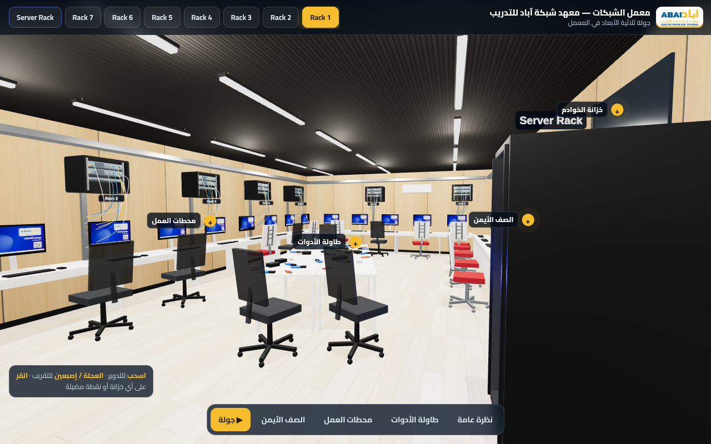

# معمل الشبكات — معهد شبكة آباد للتدريب

نسخة ثلاثية الأبعاد تفاعلية لمعمل الشبكات (three.js): اختيار الخزائن Rack 1–7 وخزانة الخوادم، وأجهزة Cisco في كل خزانة، ونقاط تفاعلية وجولة تلقائية.

- الصفحة الرئيسية: `index.html` (مجسّم المعمل)
- الصفحة السابقة: `topology.html` (مخطط الشبكة)

